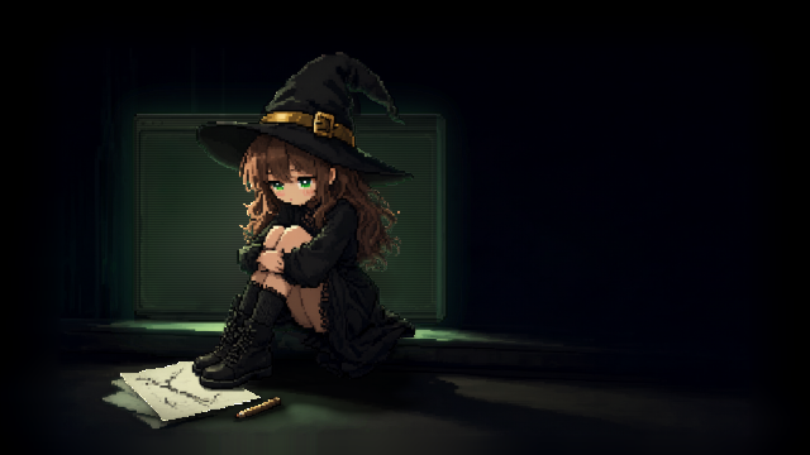

# Kiki // Terminal



A Wallpaper Engine web wallpaper built from a single 1664×960 pixel-art frame: a
witch asleep in front of an old CRT, with a terminal on the glass that scrolls a
row at a time, a lamp that steps through sixteen brightness levels, and a light
that lands on her hat, her hair and the floor.

Everything is authored on one **640×360 logical grid** and blown up by a single
integer transform — 3× at 1080p, 4× at 1440p, 6× at 4K — so a logical pixel is
always a whole number of device pixels and no layer is ever resampled. Nothing is
fetched at runtime: no CDN, no fonts, no network.

## Install

Drop the whole `wallpaper/` folder into Wallpaper Engine ("Create Wallpaper" →
pick `index.html`), or copy it into
`wallpaper_engine/projects/myprojects/` and open it from the editor.

Ship **every** file in the folder. A missing layer renders as nothing at all,
silently, and reads like a bug in the animation.

## Rebuild

The wallpaper is generated. `wallpaper/layers/` is 16 PNGs the pipeline writes;
nothing in it is hand-edited.

```bash
python3 -m venv .venv
./.venv/bin/pip install -r requirements.txt

tools/build_all.sh                       # ~46 s, reference/ -> wallpaper/layers/
./.venv/bin/python tools/verify.py       # 87 checks, ~1 s
```

numpy and Pillow, nothing else. No GPU, no display, no network.

The build is deterministic — no model inference, no randomness, no timestamps —
so the honest test after a change is:

```bash
tools/build_all.sh && git status --short wallpaper/layers/
```

An empty diff means the run reproduced the art exactly; a non-empty one means
the art moved, and the diff is the change. `verify.py` is the fast gate: it
reads the shipped PNGs and `index.html` and binds the invariants each stage is
supposed to hold.

## What is in here

| | |
|---|---|
| `wallpaper/` | the deliverable — `index.html`, `project.json`, 16 PNGs, its own [README](wallpaper/README.md) |
| `tools/` | the pipeline, one script per stage, plus `verify.py` |
| `reference/` | the two inputs a human supplied: the frame and the witch's cut-out |
| `build/` | everything derived. 113 MB, ignored by git, rebuilt in 46 s |
| `.agents/` | the agent docs and the writing skills this repo is documented with |

## The wallpaper itself

Layer by layer, the two palettes, the five animations and the property table are
in [`wallpaper/README.md`](wallpaper/README.md) — that file ships with the
wallpaper and is written for someone opening the folder.

The build — the seven stages, the shared geometry constants and the numbers this
README quotes — is in [`.agents/docs/pipeline.md`](.agents/docs/pipeline.md).

## Provenance

The reference frame and the witch's alpha channel came from a local ComfyUI
(*Remove Background: Qwen Image 2.1*); both are frozen in `reference/` and the
pipeline consumes those files, not a model. The shut eyelids were **not** made
with the image model — the edit template returned her with her eyes open and a
dragon added to the room, so the lids are authored by hand in
`tools/make_blink.py`.
